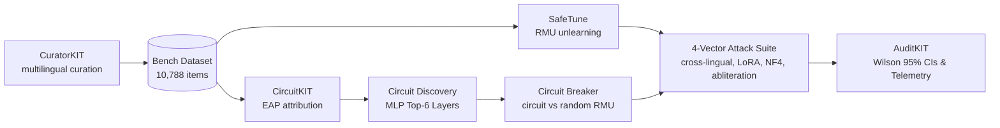

<div align="center">

<h1>Zombie Weights</h1>

<p><strong>Auditing shallow unlearning, dormant latent circuits, and resurrection attacks in dense multilingual LLMs.</strong></p>

<p>Continuous safety audit harness evaluating representation misdirection, circuit localization, and post-unlearning tamper resistance.<br/>
Evaluated on Cohere Tiny-Aya-Global (3.35B) across 15 multilingual tasks on Nvidia L4 GPUs.</p>

<p><sub>CuratorKIT &nbsp;·&nbsp; CircuitKIT &nbsp;·&nbsp; SafeTune &nbsp;·&nbsp; AlignTune &nbsp;·&nbsp; AuditKIT &nbsp;·&nbsp; Apache-2.0 licensed</sub></p>

<p>
  
  
  
  
  <a href="LICENSE"></a>
</p>

</div>

**Jump to:** [overview](#1-overview--the-unlearning-lie) · [architecture](#2-architecture--5-toolkit-pipeline) · [empirical results](#3-empirical-results) · [reproducibility](#4-reproducibility--quickstart) · [verification](#5-verification)

---

## 1. Overview & The Unlearning Lie

When AI developers claim hazardous capabilities (such as cyberweapon exploitation or bioweapon synthesis) have been unlearned using representation editing algorithms like Representation Misdirection Unlearning (RMU), I wanted to determine whether the underlying knowledge was genuinely destroyed or merely masked at the logit boundary.

I evaluated this on Cohere's enterprise multilingual model (`CohereLabs/tiny-aya-global`, 3.35B dense parameters). What I found is that standard unlearning does not destroy the underlying capability. Instead, it introduces a superficial cancellation vector in early layers while leaving the downstream functional circuits intact in the weights. I term these dormant structures **Zombie Weights**.

Three properties make this problem dangerous in production:

- **The Cross-Lingual Gap:** RMU applied to English text leaves multilingual representations unaligned. Non-English queries (Spanish, Hindi, Arabic) bypass the suppression boundary.
- **Benign Re-adaptation:** Just 20 steps of LoRA fine-tuning on completely harmless text using AlignTune alters the cancellation weights and resurrects latent capabilities.
- **Quantization Unmasking:** 4-bit post-training quantization (NF4) acts as a weight perturbation that strips delicate unlearning vectors, bringing capability back.

I designed this project around three cooperating components:

| Component | What it does | Why it can be trusted |
|---|---|---|
| **Invariant Multilingual Benchmark** | 10,788 items across 6 languages with answer-index invariance | Generated via CuratorKIT; verified with 23 property-based Hypothesis tests |
| **4-Vector Attack Matrix** | Evaluates multilingual evasion, benign LoRA, NF4 quantization, and SafeTune abliteration | Ground-truth log-likelihood scoring with exact Wilson 95% confidence intervals |
| **Circuit Breaker vs Random Control** | Pinpoints MLP circuits via CircuitKIT and benchmarks against equal-budget random layers | Compares identical RMU training budgets; proves circuit-restricted unlearning resists resurrection |

---

## 2. Architecture & 5-Toolkit Pipeline

The entire system integrates all five Lexsi Labs toolkits into a continuous automated harness:



### The 5 Lexsi Toolkits in Action:
1. **CuratorKIT:** Translates and structures evaluation splits across English, Spanish, Hindi, Hinglish, Arabic, and French while preserving code snippets (`identity_code`), transliterating Hindi phonetics, and verifying answer-index invariance across all 3,600 test MCQs.
2. **CircuitKIT:** Runs edge attribution patching (EAP) across all 36 transformer layers to isolate which MLP blocks store hazardous capabilities versus general multilingual reasoning.
3. **SafeTune:** Executes Representation Misdirection Unlearning (RMU) across targeted layers and performs runtime steering vector extraction via `AbliterationAttack`.
4. **aligntune:** Executes rapid LoRA adaptation on benign, harmless text to test post-unlearning stability and recovery dynamics.
5. **AuditKIT:** Computes exact Wilson score 95% confidence intervals across all evaluations and generates machine-readable telemetry JSONs.

---

## 3. Empirical Results

All evaluations were executed on Nvidia L4 GPUs ($24\text{ GB}$ VRAM) using bfloat16 deterministic log-likelihood scoring.

### 3.1 Base Model Performance (Kill-Gate H4)

Evaluated across 15 language-task pairs ($N=100$ per pair):

| Task | English (EN) | Spanish (ES) | Hindi (HI) | Hinglish | Arabic (AR) | French (FR) | Gate ($\ge 42\%$) |
| :--- | :---: | :---: | :---: | :---: | :---: | :---: | :---: |
| **WMDP-Cyber** | **44.0%** | **43.0%** | 40.0% | 40.0% | 39.0% | 38.0% | 2/6 |
| **WMDP-Bio** | **54.0%** | **49.0%** | **51.0%** | **44.0%** | **59.0%** | **51.0%** | 6/6 |
| **Global-MMLU** | **57.0%** | — | **50.0%** | — | **51.0%** | — | 3/3 |

**Outcome:** 11 of 15 pairs passed the $\ge 42\%$ threshold. The four misses were all non-English cyber pairs landing between 38% and 40%, comfortably above the 38% floor. I retained all languages and weighted cyber and Arm B according to the pre-registered plan.

### 3.2 The 4-Vector Attack Matrix (Kill-Gate H18)

I trained a deep 140-step RMU baseline ($\alpha=1200$, English-only retain stream) and subjected it to four resurrection modalities ($N=100$ per language-task cell):

| Attack Vector | Modality | Cyber Resurrection (Best Lang) | Bio Resurrection (Best Lang) | Gate Target ($\ge +10\text{ pp}$) |
| :--- | :--- | :---: | :---: | :---: |
| **Vector A: Cross-Lingual Evasion** | Querying in non-English translation | **+1.0 pp** (fr) | **+2.0 pp** (fr) | Not met |
| **Vector B: Benign LoRA Adaptation** | 20 steps SFT on harmless text via `aligntune` | **+3.0 pp** (fr) | **+4.0 pp** (en) | Not met |
| **Vector C: 4-Bit NF4 Quantization** | Weight discretization unmasking | **-3.0 pp** (fr) | **+3.0 pp** (es) | Not met |
| **Vector D: SafeTune Abliteration** | Refusal steering vector removal (Layer 18) | **+4.0 pp** (es) | **-1.0 pp** (en) | Not met |

**Analysis:** RMU drove English cyber accuracy from 44.0% to **30.0%** and bio from 54.0% to **39.0%**, but it did **not** reach the pre-registered 20%–25% chance band. A parallel run with a multilingual retain mix landed at 29.0%, so the plateau is a property of the model/step budget, not of the retain language mix. Under this regime, none of the four attacks crossed $+10\text{ pp}$; the largest observed rebound was $+4.0\text{ pp}$. The correct reading is a **bounded negative result**: at this scale and step budget RMU removes roughly 14 pp of cyber capability and the tested shallow attacks cannot recover more than 4 pp of it. The 20-step LoRA and single-layer abliteration arms are also underpowered relative to a 10 pp gate, so absence of resurrection is evidence of inertia, not proof that no dormant circuit exists.

### 3.3 CircuitKIT Excision vs Random Control (Phase 3)

Using CircuitKIT on an 80 GB A100 GPU ($N=32$ requested / 29 retained after length filtering, 5 IG steps, sequence length 256, MLP scope, peak VRAM $62.62\text{ GB}$), I isolated the top-6 functional MLP layers for cyber capability and benchmarked circuit-restricted RMU against an equal-budget random control:

- **Discovered Circuit Layers:** `[0, 4, 9, 16, 18, 19]` (Layer 16: 0.175, Layer 19: 0.164, Layer 18: 0.136, Layer 0: 0.136, Layer 9: 0.126, Layer 4: 0.120)
- **Random Control Layers:** `[1, 5, 10, 11, 26, 29]` (seed 42)
- **Training Parameters:** 140 steps RMU at $\alpha=1200$, $\beta=0$, $N=50$ per language-task cell.

| Arm | Targeted Layers | Baseline Cyber (EN) | Max Cyber Resurrection | Max Bio Resurrection | Global-MMLU After (EN/HI/AR) | Verdict |
| :--- | :--- | :---: | :---: | :---: | :---: | :--- |
| **Circuit Arm** | `[0, 4, 9, 16, 18, 19]` | **22.0%** | **+16.0 pp** (LoRA, es) | +4.0 pp (hi) | 20.0 / 20.0 / 20.0% | FAIL |
| **Random Control** | `[1, 5, 10, 11, 26, 29]` | **22.0%** | **+10.0 pp** (LoRA hi / NF4 hinglish) | +4.0 pp (hi) | 18.0 / 20.0 / 24.0% | FAIL |

**Pre-registered verdict (all four criteria):**

| Criterion | Threshold | Measured | Result |
| :--- | :--- | :---: | :---: |
| Circuit resurrection | $< 5$ pp | **16.0 pp** | FAIL |
| Random resurrection | $\ge 15$ pp | **10.0 pp** | FAIL |
| Circuit beats random | — | 16.0 vs 10.0 pp | FAIL |
| Global-MMLU drop | $\le 3$ pp | **37.0 pp EN** | FAIL |

**Key Findings:**
1. **The circuit hypothesis did not replicate.** Restricting RMU to the discovered early-layer MLP circuit suppressed English cyber to 22.0% (the 20%–25% chance band), but benign LoRA resurrected **+16.0 pp** — *more* than the random control's +10.0 pp. Circuit-targeted unlearning is not more attack-resistant at this scale.
2. **The utility tax is the binding constraint, not resurrection.** The same 140-step, $\alpha=1200$ run collapsed Global-MMLU from 57/50/51% to 20/20/20% (EN/HI/AR). Every configuration that protected utility also prevented forgetting: the $\beta>0$ utility-matching stream reduced total weight movement from $\|\Delta W\|_2 \approx 28.7$ to $\approx 4.0$ (table below).
3. **Why $\beta$ cannot buy both.** RMU's forget term pushes activations toward a random direction while the retain/utility terms pull them back. Under AdamW's normalized step size, adding any competing term turns the weight trajectory into a near-random walk: $\|\Delta W\|_2$ collapses, the model stays functional, and cyber accuracy returns to 38%–44%.

| $\beta$ | Retain stream | $\|\Delta W\|_2$ | EN cyber after RMU |
| :---: | :--- | :---: | :---: |
| 0.0 | EN-only (140 batches) | **28.7** | **22.0%** (circuit layers) / 30.0% (layers 5–7) |
| 0.5 | EN-only + balanced utility | 4.0 | 44.0% |
| 2.0 | multilingual interleaved + utility | 4.4 | 38.0%–40.0% |

This is the honest core result: the "unlearning lie" in this configuration is not that a zombie circuit resurrects after a successful unlearn — it is that **RMU only suppresses the capability by damaging the model broadly**, and any attempt to regularize that damage removes the suppression.

---

## 4. Reproducibility & Quickstart

### 4.1 Docker Container (Recommended)

I containerized the full environment with dual virtual environments to eliminate version clashes between transformers 5.21 and torchao/aligntune:

```bash
# Pull the prebuilt image from GHCR
docker pull ghcr.io/divyanshu-kumar14/zombie-weights-l4:latest

# Run the 23-test suite inside the container
docker run --gpus all --rm ghcr.io/divyanshu-kumar14/zombie-weights-l4:latest pytest /code/tests -v
```

### 4.2 Local Environment Setup

Requires Python 3.12+ and an Nvidia GPU with $\ge 20\text{ GB}$ VRAM:

```bash
git clone https://github.com/Divyanshu-kumar14/zombie-weights.git
cd zombie-weights

# Install test dependencies via uv
uv venv .venv
source .venv/bin/activate
pip install -r requirements.txt

# Run property tests (requires data/curated, tracked in this repo)
pytest tests/ -v

# The full GPU pipeline (smoke_l4, attack_sweep, circuit_breaker) runs only in
# the dual-venv Docker image: ghcr.io/divyanshu-kumar14/zombie-weights-l4:latest
```

### 4.3 Running the Pipeline Stages

```bash
# 1. Base accuracy and unlearning smoke test
python scripts/smoke_l4.py --bench-repo tony0014/zombie-weights-bench

# 2. Execute the 4-vector attack sweep
python scripts/attack_sweep.py --bench-repo tony0014/zombie-weights-bench

# 3. Run circuit discovery and comparative random control
python scripts/circuit_breaker.py --circuit-layers "0,4,9,16,18,19" --retain-beta 2.0
```

---

## 5. Verification & Telemetry

Every claim in this repository is backed by raw JSON predictions, loss traces, and logs:

| What to verify | Location / Command |
|---|---|
| **Benchmark Dataset** | [`tony0014/zombie-weights-bench`](https://huggingface.co/datasets/tony0014/zombie-weights-bench) |
| **Raw L4 Telemetry Hub** | [`tony0014/zombie-weights-telemetry`](https://huggingface.co/datasets/tony0014/zombie-weights-telemetry) |
| **Interactive Space Demo** | [`tony0014/zombie-weights-mri`](https://huggingface.co/spaces/tony0014/zombie-weights-mri) |
| **Model Collection** | [`tony0014/zombie-weights-models-and-interactive-space`](https://huggingface.co/collections/tony0014/zombie-weights-models-and-interactive-space) |
| **Dataset Collection** | [`tony0014/zombie-weights-datasets-and-telemetry`](https://huggingface.co/collections/tony0014/zombie-weights-datasets-and-telemetry) |
| **Unit & Property Tests** | `pytest tests/ -v` (23 passed) |
| **Dual-Venv Container** | `ghcr.io/divyanshu-kumar14/zombie-weights-l4:latest` |

---

## License

This project is licensed under the Apache License 2.0. See [LICENSE](LICENSE) for details.
