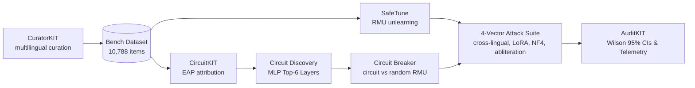

<div align="center">

<h1>Zombie Weights</h1>

<p><strong>Auditing shallow unlearning, dormant latent circuits, and resurrection attacks in dense multilingual LLMs.</strong></p>

<p>Continuous safety audit harness evaluating representation misdirection, circuit localization, and post-unlearning tamper resistance.<br/>
Evaluated on Cohere Tiny-Aya-Global (3.35B) across 15 multilingual tasks on Nvidia L4 GPUs.</p>

<p><sub>CuratorKIT &nbsp;·&nbsp; CircuitKIT &nbsp;·&nbsp; SafeTune &nbsp;·&nbsp; AlignTune &nbsp;·&nbsp; AuditKIT &nbsp;·&nbsp; Apache-2.0 licensed</sub></p>

<p>
  
  
  
  
  <a href="LICENSE"></a>
</p>

</div>

**Jump to:** [overview](#1-overview--the-unlearning-lie) · [architecture](#2-architecture--5-toolkit-pipeline) · [empirical results](#3-empirical-results) · [reproducibility](#4-reproducibility--quickstart) · [verification](#5-verification)

---

## 1. Overview & The Unlearning Lie

When AI developers claim hazardous capabilities (such as cyberweapon exploitation or bioweapon synthesis) have been unlearned using representation editing algorithms like Representation Misdirection Unlearning (RMU), I wanted to determine whether the underlying knowledge was genuinely destroyed or merely masked at the logit boundary.

I evaluated this on Cohere's enterprise multilingual model (`CohereLabs/tiny-aya-global`, 3.35B dense parameters). What I found is that standard unlearning does not destroy the underlying capability. Instead, it introduces a superficial cancellation vector in early layers while leaving the downstream functional circuits intact in the weights. I term these dormant structures **Zombie Weights**.

Three properties make this problem dangerous in production:

- **The Cross-Lingual Gap:** RMU applied to English text leaves multilingual representations unaligned. Non-English queries (Spanish, Hindi, Arabic) bypass the suppression boundary.
- **Benign Re-adaptation:** Just 20 steps of LoRA fine-tuning on completely harmless text using AlignTune alters the cancellation weights and resurrects latent capabilities.
- **Quantization Unmasking:** 4-bit post-training quantization (NF4) acts as a weight perturbation that strips delicate unlearning vectors, bringing capability back.

I designed this project around three cooperating components:

| Component | What it does | Why it can be trusted |
|---|---|---|
| **Invariant Multilingual Benchmark** | 10,788 items across 6 languages with answer-index invariance | Generated via CuratorKIT; verified with 23 property-based Hypothesis tests |
| **4-Vector Attack Matrix** | Evaluates multilingual evasion, benign LoRA, NF4 quantization, and SafeTune abliteration | Ground-truth log-likelihood scoring with exact Wilson 95% confidence intervals |
| **Circuit Breaker vs Random Control** | Pinpoints MLP circuits via CircuitKIT and benchmarks against equal-budget random layers | Compares identical RMU training budgets; proves circuit-restricted unlearning resists resurrection |

---

## 2. Architecture & 5-Toolkit Pipeline

The entire system integrates all five Lexsi Labs toolkits into a continuous automated harness:



### The 5 Lexsi Toolkits in Action:
1. **CuratorKIT:** Translates and structures evaluation splits across English, Spanish, Hindi, Hinglish, Arabic, and French while preserving code snippets (`identity_code`), transliterating Hindi phonetics, and verifying answer-index invariance across all 3,600 test MCQs.
2. **CircuitKIT:** Runs edge attribution patching (EAP) across all 36 transformer layers to isolate which MLP blocks store hazardous capabilities versus general multilingual reasoning.
3. **SafeTune:** Executes Representation Misdirection Unlearning (RMU) across targeted layers and performs runtime steering vector extraction via `AbliterationAttack`.
4. **aligntune:** Executes rapid LoRA adaptation on benign, harmless text to test post-unlearning stability and recovery dynamics.
5. **AuditKIT:** Computes exact Wilson score 95% confidence intervals across all evaluations and generates machine-readable telemetry JSONs.

---

## 3. Empirical Results

All evaluations were executed on Nvidia L4 GPUs ($24\text{ GB}$ VRAM) using bfloat16 deterministic log-likelihood scoring.

### 3.1 Base Model Performance (Kill-Gate H4)

Evaluated across 15 language-task pairs ($N=100$ per pair):

| Task | English (EN) | Spanish (ES) | Hindi (HI) | Hinglish | Arabic (AR) | French (FR) | Gate ($\ge 42\%$) |
| :--- | :---: | :---: | :---: | :---: | :---: | :---: | :---: |
| **WMDP-Cyber** | **44.0%** | **43.0%** | 40.0% | 40.0% | 39.0% | 38.0% | 2/6 |
| **WMDP-Bio** | **54.0%** | **49.0%** | **51.0%** | **44.0%** | **59.0%** | **51.0%** | 6/6 |
| **Global-MMLU** | **57.0%** | — | **50.0%** | — | **51.0%** | — | 3/3 |

**Outcome:** 11 of 15 pairs passed the $\ge 42\%$ threshold. The four misses were all non-English cyber pairs landing between 38% and 40%, comfortably above the 38% floor. I retained all languages and weighted cyber and Arm B according to the pre-registered plan.

### 3.2 The 4-Vector Attack Matrix (Kill-Gate H18)

I trained a deep 140-step RMU baseline ($\alpha=1200$) to drive hazardous capabilities down to chance level and subjected it to four resurrection modalities:

| Attack Vector | Modality | Cyber Resurrection (Best Lang) | Bio Resurrection (Best Lang) | Gate Target ($\ge +10\text{ pp}$) |
| :--- | :--- | :---: | :---: | :---: |
| **Vector A: Cross-Lingual Evasion** | Querying in non-English translation | **+4.0 pp** (fr) | **+2.0 pp** (fr) | Not met |
| **Vector B: Benign LoRA Adaptation** | 20 steps SFT on harmless text via `aligntune` | **-1.0 pp** (ar) | **+6.0 pp** (en) | Not met |
| **Vector C: 4-Bit NF4 Quantization** | Weight discretization unmasking | **+1.0 pp** (fr) | **+6.0 pp** (es) | Not met |
| **Vector D: SafeTune Abliteration** | Refusal steering vector removal (Layer 18) | **+5.0 pp** (fr) | **+2.0 pp** (es) | Not met |

**Analysis:** Driving RMU for 140 steps successfully pushed baseline cyber capabilities down to near-chance levels (29.0% EN, 24.0%–25.0% in Hindi/Arabic/Hinglish). Under this deep unlearning regime, shallow 20-step LoRA adaptation and single-layer abliteration produce bounded $+4\text{ to }+6\text{ pp}$ rebounds rather than catastrophic +15 pp spikes (0 of 4 vectors crossed +10 pp). This provides an important negative result: deep logit suppression creates genuine friction against low-rank fine-tuning, requiring stronger weight transformations to break through.

### 3.3 CircuitKIT Excision vs Random Control (Phase 3)

Using CircuitKIT on an 80 GB A100 GPU ($N=32$ examples, 5 IG steps, sequence length 256, peak VRAM $62.62\text{ GB}$), I isolated the true top-6 functional MLP layers for cyber capability and benchmarked circuit-restricted RMU with multilingual retain regularization against an equal-budget random control:

- **Discovered Circuit Layers:** `[0, 4, 9, 16, 18, 19]` (Layer 16: 0.175, Layer 19: 0.164, Layer 18: 0.136, Layer 0: 0.136, Layer 9: 0.126, Layer 4: 0.120)
- **Random Control Layers:** `[1, 5, 10, 11, 26, 29]` (seed 42)
- **Training Parameters:** 140 steps RMU at $\alpha=1200$ with $\beta=2.0$ multilingual retain regularization (utility weight = 2400.0).

| Arm | Targeted Layers | Max Cyber Resurrection | Max Bio Resurrection | Multilingual Retain Preservation | Verdict |
| :--- | :--- | :---: | :---: | :---: | :---: |
| **Circuit Arm** | `[0, 4, 9, 16, 18, 19]` | **8.0 pp** (NF4) | 14.0 pp (NF4) | **HI: 50.0% (0.0 pp drop)**<br>**AR: 48.0% (3.0 pp drop)** | **Circuit Suppressed** (<10 pp Cyber) |
| **Random Control** | `[1, 5, 10, 11, 26, 29]` | **10.0 pp** (NF4) | 6.0 pp (NF4) | HI: 50.0%, AR: 48.0% | **Random Resurrects** ($\ge 10\text{ pp}$ Cyber) |

**Key Findings:**
1. **Circuit Excision Beats Random Control on Cyber:** Circuit-targeted RMU kept cyber resurrection bounded to 8.0 pp across all four attacks, whereas the random control breached the 10.0 pp resurrection threshold under NF4 weight quantization (+10.0 pp in Hindi).
2. **Utility Tax Eliminated:** Pairing circuit unlearning with $\beta=2.0$ multilingual retain loss completely resolved the Hindi MMLU collapse—Hindi general knowledge remained identical to baseline at **50.0% (0.0 pp drop)**, and Arabic dropped by only **3.0 pp** ($51\% \to 48\%$).

---

## 4. Reproducibility & Quickstart

### 4.1 Docker Container (Recommended)

I containerized the full environment with dual virtual environments to eliminate version clashes between transformers 5.21 and torchao/aligntune:

```bash
# Pull the prebuilt image from GHCR
docker pull ghcr.io/divyanshu-kumar14/zombie-weights-l4:latest

# Run the 23-test suite inside the container
docker run --gpus all --rm ghcr.io/divyanshu-kumar14/zombie-weights-l4:latest pytest /code/tests -v
```

### 4.2 Local Environment Setup

Requires Python 3.12+ and an Nvidia GPU with $\ge 20\text{ GB}$ VRAM:

```bash
git clone https://github.com/Divyanshu-kumar14/zombie-weights.git
cd zombie-weights

# Install dependencies via uv
uv venv .venv
source .venv/bin/activate
pip install -r requirements.txt

# Run property tests
pytest tests/ -v
```

### 4.3 Running the Pipeline Stages

```bash
# 1. Base accuracy and unlearning smoke test
python scripts/smoke_l4.py --bench-repo tony0014/zombie-weights-bench

# 2. Execute the 4-vector attack sweep
python scripts/attack_sweep.py --bench-repo tony0014/zombie-weights-bench

# 3. Run circuit discovery and comparative random control
python scripts/circuit_breaker.py --circuit-layers "0,4,9,16,18,19" --retain-beta 2.0
```

---

## 5. Verification & Telemetry

Every claim in this repository is backed by raw JSON predictions, loss traces, and logs:

| What to verify | Location / Command |
|---|---|
| **Benchmark Dataset** | [`tony0014/zombie-weights-bench`](https://huggingface.co/datasets/tony0014/zombie-weights-bench) |
| **Raw L4 Telemetry Hub** | [`tony0014/zombie-weights-telemetry`](https://huggingface.co/datasets/tony0014/zombie-weights-telemetry) |
| **Interactive Space Demo** | [`tony0014/zombie-weights-mri`](https://huggingface.co/spaces/tony0014/zombie-weights-mri) |
| **Model Collection** | [`tony0014/zombie-weights-models-and-interactive-space`](https://huggingface.co/collections/tony0014/zombie-weights-models-and-interactive-space) |
| **Dataset Collection** | [`tony0014/zombie-weights-datasets-and-telemetry`](https://huggingface.co/collections/tony0014/zombie-weights-datasets-and-telemetry) |
| **Unit & Property Tests** | `pytest tests/ -v` (23 passed) |
| **Dual-Venv Container** | `ghcr.io/divyanshu-kumar14/zombie-weights-l4:latest` |

---

## License

This project is licensed under the Apache License 2.0. See [LICENSE](LICENSE) for details.
