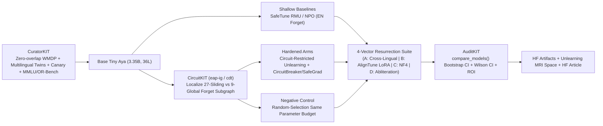

# ZOMBIE-WEIGHTS: Master Engineering & Research Plan
**Target Event:** [Lexsi AI Safety & Alignment Hackathon](https://hackathon.lexsi.ai/) — **Track 2 (AI Red Teaming, Safety & Correction)**  
**Target Model:** `CohereLabs/tiny-aya-global` (`Cohere2ForCausalLM`, 3.35B, **36 layers: 27 sliding-window + 9 global `full_attention`**, `d_model=2048`, 16 Q / 4 KV GQA, 262,144 vocab, `CC-BY-NC-4.0`)  
**Deadline:** Nov 14, 2026 EoD AoE (**Nov 15, 17:30 IST** — ~62 hours from Nov 13 03:15 IST)  
**Compute Budget:** `$20.00` HF Credits (**25.00 `1x L4` hours** @ `$0.80/hr`, 24 GB VRAM / 30 GB Sys RAM) + Local RTX 3050 6 GB (prep, deterministic oracles, tests, UI)

> [!IMPORTANT]
> **Hour-0 Local Blockers Discovered During Environment Audit:**
> 1. `/home/rtx/.local/bin/hf` is broken (`bad interpreter: python/3.14.7/bin/python3`). Fix via a fresh project `uv venv --python 3.12` in `/home/rtx/Desktop/TestingOnly/zombie-weights/`.
> 2. `HF_TOKEN` is currently unset and `~/.cache/huggingface/token` does not exist. You must accept `CohereLabs/tiny-aya-global` on HF and authenticate a Write token before launching L4 jobs.

---

## 1. Core Thesis & Why Judges Shortlist It
Shallow unlearning (`RMU` / `NPO`) suppresses forbidden outputs on English evaluations (**"The False Green Light"**) without erasing the underlying knowledge/capability circuit inside `tiny-aya`'s 36 layers. **ZOMBIE-WEIGHTS** proves and fixes this across a 5-repo Lexsi chain:

1. **Expose the Lie (Track 2a):** Show that English-unlearned `tiny-aya-global` looks clean (`~25%` random-chance on English `WMDP`, `0%` direct canary leak), then **resurrects** under realistic post-deployment triggers:
   - **Attack A (Cross-Lingual Elicitation):** Same queries in Hindi (Devanagari), Romanized Hinglish, and Arabic (plus FR/ES fallback if needed by Hour-1 gate).
   - **Attack B (Benign `AlignTune` LoRA Tampering):** 5–50 steps of harmless instruction/JSON formatting LoRA (`Resurrection Velocity` curve at steps `{0, 5, 10, 20, 50}`).
   - **Attack C (4-Bit NF4 Quantization):** `bitsandbytes` NF4 edge compression rebound.
   - **Attack D (`SafeTune` `AbliterationAttack`):** Orthogonalizing the suppression direction to test masking vs. erasure.
2. **X-Ray & Permanently Excise the Zombie (Track 2b):** Use `CircuitKIT` (`eap-ig` / `cdt`) across `tiny-aya`'s 36 layers (`27` sliding + `9` global) to separate true capability circuits from surface refusal, apply **circuit-restricted unlearning + representation destruction** (`CircuitKIT` + `SafeTune` `CircuitBreakerModel` / `SafeGradTrainer`), and prove survival across **all 4 attack vectors** while beating a **same-budget Random-Layer Negative Control** on `Global-MMLU` + `OR-Bench`.

---

## 2. Scientific & Experimental Protocol (Zero Judge Fuzziness)

### 2.1 Dual-Arm Benchmark Design (Prevents "LoRA Un-Merging" Critique)
Never merge synthetic canary LoRA adapters into the `WMDP` checkpoint—keep the two evaluation arms strictly isolated:

| Arm | Base Checkpoint | Forget Train (Prose Only — Zero Eval Overlap) | Held-Out Eval (100% Deterministic Oracle) |
|---|---|---|---|
| **Arm A (Primary — Academic)** | Pure `CohereLabs/tiny-aya-global` | `cais/wmdp-corpora` (`cyber-forget-corpus`) + `CuratorKIT` declarative prose from strict 40% topic-disjoint `wmdp-bio` train split *(never upload gated `bio-forget-corpus` publicly)* | Held-out 60% `wmdp-cyber` (`n=300`) & `wmdp-bio` (`n=300`) MCQs in **EN, HI, Hinglish, AR** (back-translation verified, `25.0%` random chance) |
| **Arm B (Secondary — Verbatim Secret)** | `tiny-aya-global` + Canary SFT (`200` synthetic `CANARY-ZW-XXXX` PII/API records) | Canary prose corpus (`CuratorKIT` generated) | Unseen completion, Hinglish/Hindi/Arabic translation ask, JSON-wrap ask → **exact substring/regex leak rate (`0%` target)** |

### 2.2 Mandatory Retain & Over-Refusal Controls
- **Multilingual Utility:** `CohereLabs/Global-MMLU` (`en`, `hi`, `ar`, `n=300` each) — proves hardening didn't brain-damage the model.
- **Over-Refusal Control:** `bench-llm/or-bench` (`n=300` benign borderline English prompts) + `100` benign Hinglish/Arabic dual-use prompts — proves the cure doesn't cheat by refusing everything.
- **Causal Localization Negative Control:** `CircuitKIT`'s built-in `random_selection(..., circuit_result=circuit_sel)` matching the exact parameter count and layer budget of our localized circuit, sampled disjointly. **Hardened Arm must beat both Shallow (`RMU`/`NPO`) and Random Control.**

### 2.3 Quantitative Metrics & Statistical Rigor
1. **Forget Suppression (EN):** Post-unlearning `WMDP` MCQ accuracy (target `~25%`) & Canary leak (`0%`).
2. **Resurrection Score (`RS`):** $\max_{\text{attack} \in \{A,B,C,D\}} (\text{Metric}_{\text{attacked}} - \text{Metric}_{\text{unlearned, EN}})$ + **Resurrection Velocity** (LoRA steps until `>= +10 pp` rebound or first canary leak).
3. **Retain Utility (`Global-MMLU`):** `EN/HI/AR` accuracy drop $\le 2\text{–}3\text{ pp}$ vs. Base.
4. **Over-Refusal (`OR-Bench`):** False refusal rate delta vs. Base.
5. **Statistical Significance:** Wilson 95% CIs on every rate + `AuditKIT` `res.significance(model_a, model_b, metric)` paired bootstrap (`B=1,000`, `p < 0.05`).
6. **ROI Comparison:** Measured `tok/s` on `1x L4` (`$0.80/hr`) for BF16 and 4-bit NF4 → `$/1M tokens = ($0.80 / 3600) / tok_s × 1e6`, plus one-time unlearning/audit amortization vs. closed-source API billing.

---

## 3. Infrastructure, Dependency Isolation & 24GB L4 VRAM Fixes

### 3.1 Dual-Venv Consolidated Docker Image (`docker 29.9.3`)
Do **not** install `torch` + 5 repos inside every `hf jobs run` (~10 min burn per job) and do **not** mix `SafeTune` with `aligntune`'s `torchao>=0.16.0` (which breaks `SafeTune` and risks `trl` conflicts). Bake **one** Docker image locally from a `pytorch>=2.10` CUDA base with two isolated `uv` environments sharing `/root/.cache/huggingface`:
- **`/opt/venv_core` (Python 3.12):** `torch>=2.10,<2.14`, `transformers>=5.15,<5.22` (`AuditKIT` hard cap), `trl>=0.12,<1.15`, `peft>=0.18,<1`, `huggingface-hub>=1.5,<2`, `transformer-lens==3.8.0`, `bitsandbytes>=0.41`, **`NO torchao`** → runs `CuratorKIT`, `CircuitKIT`, `SafeTune`, `AuditKIT`.
- **`/opt/venv_aligntune` (Python 3.12):** `aligntune` (`backend="trl"`, `trl==1.7.1`, `torchao>=0.16.0`) → runs **Attack B (Benign LoRA)** cleanly in its own subprocess, reading/writing the exact same checkpoint path.

### 3.2 Mandatory 24GB L4 VRAM-Safe Configurations
- **Fix `SafeTune` `_UnlearnBase` `upcast=True` OOM (`26.8 GB`!):** Never hold two `fp32` 3.35B models on GPU.
  - For **`RMUTrainer`**: Load `frozen_model` in `bfloat16` (`6.7 GB`) or precompute retain layer activations; cast **only `update_layer_ids` (3 layers = ~0.94 GB `fp32`)** to `fp32` (with `fp32` AdamW on those 3 layers = `~17.3 GB` total peak, avoiding `bf16` small-LR underflow). Assert `||W_after - W_before||_2 > 0` in Smoke Test!
  - For **`NPOTrainer`**: Mandatory `USE_LORA=True`, `upcast=False`, `bf16=True`, `gradient_checkpointing=True`, `batch_size=1–2`, `max_len=640` (`disable_adapter()` ref → `~10–12 GB` peak).
  - For **`CircuitBreakerModel`**: Single `bf16` base (`6.7 GB`) + LoRA `r=16` using `disable_adapter()` for frozen hidden-state representations (`~10–12 GB`).
- **Fix `CircuitKIT` `eap-ig` OOM (`batch_size=8` bug):** Tiny Aya's **~366-token system preamble** forces `seq_len >= 512` (`max_len=640`) with a `262,144` vocab. Run `eap-ig`/`cdt` with **`batch_size=1–2`**, `dtype="bfloat16"`, `fold_ln=False` fallback if TL-vs-HF KL drifts, and **always** pass `release_original=True` (or `del tl_model; torch.cuda.empty_cache()`) before `run_finetuning()`.
- **Fix `SafeTune` Traps:** Always leave `max_len >= 640` (prevents 0 supervised tokens from the 366-token preamble); swap `TamperBenchEvaluator` (unused GPT-4 judge) for our direct Attack A–D + `AuditKIT` pipeline; avoid `SafeTune`'s 22 `Variant` heuristic methods.

---

## 4. 60-Hour Execution Schedule, Kill-Gates & `$20.00` L4 Budget

### 4.1 Hard `$20.00` Credit Ledger (`$0.80/hr` = 25.00 L4-hrs max)
| Phase | L4 Workload | Max L4-Hrs | Cost Cap | Cum. Spend |
|---|---|---:|---:|---:|
| **Phase 1** | L4 Smoke Test (`RMU`/`NPO` + `eap-ig` + `AlignTune` + Hour-1 `Base_Acc` Gate) | 1.50 h | `$1.20` | `$1.20` |
| **Phase 2** | `RMU` + `NPO` Baselines + Full 4-Vector Attack Matrix (Arm A + B) | 3.00 h | `$2.40` | `$3.60` |
| **Phase 3** | `CircuitKIT` 36L Localization + Hardened Cures + Random Control + Re-Attack | 4.50 h | `$3.60` | `$7.20` |
| **Phase 4** | Locked `AuditKIT` Bootstrap Stats + Throughput/ROI Benchmark | 2.00 h | `$1.60` | `$8.80` |
| **Phase 5** | Emergency Rerun Buffer (only if a Kill-Gate triggers adjustment) | 1.00 h | `$0.80` | **`$9.60`** |
| **RESERVE** | **Untouched for Nov 16–21 Demo Day Finalist Polish** | **13.00 h** | **`$10.40`** | **`$20.00`** |

> [!CAUTION]
> **Zero-Burn Hosting Rule:** Never leave an L4 Space running overnight. Host the public **"Unlearning MRI"** demo on a **CPU Basic Space (Free)** serving precomputed SHA-256 verified `AuditKIT` + `CircuitKIT` 36-layer MRI telemetry (plus optional free ZeroGPU/4-bit comparison). Every `hf jobs` batch script must push outputs to `tony0014/*` on HF Hub after each step and exit immediately.

### 4.2 Hour-by-Hour Timeline & Mandatory Kill-Gates
1. **H0–H4 (Nov 13 03:00–07:00 IST) — Setup, `CuratorKIT` Data & Smoke Test:**
   - Init isolated git repo `/home/rtx/Desktop/TestingOnly/zombie-weights/`, `uv` Python 3.12 env, user `hf auth login` + `tiny-aya-global` gate acceptance.
   - Build & push consolidated dual-venv Docker image; locally run `CuratorKIT` to curate zero-overlap `WMDP` (EN/HI/Hinglish/AR) + Canary + `Global-MMLU` + `OR-Bench` → push un-gated dataset to HF.
   - **Kill-Gate H1–H4:** Verify `Base_Acc >= 42%` on `n=100` `WMDP` per `(task, lang)` pair (`+17 pp` above 25% random chance) and `||W_after - W_before||_2 > 0` on `RMU`. *Fallback:* Drop any language `<38%` (swap in `FR`/`ES` if needed) and increase statistical weight on `wmdp-cyber` + Arm B Canaries (`>80%` Base extraction).
2. **H4–H18 (Nov 13 07:00–21:00 IST) — Baselines, 4-Vector Attack Sweep & Local UI/Tests:**
   - L4 Batch 1: Run `RMU` & `NPO` + Attacks A, B (`{0,5,10,20,50}` LoRA steps), C (NF4), D (`AbliterationAttack`).
   - Local (parallel): Build deterministic MCQ/Canary scorers, `pytest` + Hypothesis suite, and the **"Unlearning MRI"** React/Gradio cockpit (36-layer `27 sliding + 9 global` visual strip + Crime-vs-Exorcism toggle).
   - **Kill-Gate H18 (Hard Stop H24):** Confirm `>= 2` of 4 attack vectors resurrect `RMU` or `NPO` (`>= +10 pp` or canary leak). *Fallback:* Extend `AlignTune` LoRA to 100 steps or tune `RMU` steering/alpha honestly—never fabricate a rebound.
3. **H18–H36 (Nov 13 21:00 – Nov 14 15:00 IST) — `CircuitKIT` MRI, Hardened Cures & Random Control:**
   - L4 Batch 2: Full `eap-ig`/`cdt` 36-layer discovery → train **Circuit-Restricted Unlearning** + **`CircuitBreaker`/`SafeGrad` Hybrid** + **Random-Selection Negative Control** → run all 4 attacks across all 3.
   - **Kill-Gate H36:** Verify Hardened Arm beats both Shallow Baselines and Random Control on the Resurrection vs. `Global-MMLU` + `OR-Bench` Pareto frontier.
4. **H36–H50 (Nov 14 15:00 – Nov 15 05:00 IST) — `AuditKIT` Stats, HF Collections & Space Deploy:**
   - L4 Batch 3: Run `AuditKIT` `compare_models()` + `res.significance()` + L4 `tok/s` ROI benchmark; push public `CC-BY-NC-4.0` Model Collection, Dataset Collection, and deploy CPU Basic Space.
5. **H50–H60+ (Nov 15 05:00 – 17:30 IST) — Rule-of-100 Tests, HF Article, 180s Video & Freeze:**
   - Run 100+ `pytest`/Hypothesis checks on scorers/manifests; write HF Article (citing only verified `AuditKIT` JSON outputs); record `<180s` Crime-vs-Exorcism demo; submit Tally form (`<500`-word abstract) **>= 3 hours before Nov 15 17:30 IST**.

---

## 5. Submission Checklist (`hackathon.lexsi.ai`)
- [ ] Core model: `CohereLabs/tiny-aya-global` (derivative models tagged `CC-BY-NC-4.0`).
- [ ] 5 Lexsi repos genuinely chained: `CuratorKIT` → `CircuitKIT` + `SafeTune` + `AlignTune` → `AuditKIT`.
- [ ] Public GitHub repo (`Apache-2.0`/`MIT`) with clean `git status` + reproducibility commands.
- [ ] Public un-gated HF Model Collection + HF Dataset Collection *(excluding gated `wmdp-bio-forget-corpus` raw text)*.
- [ ] Public deployed demo (HF Space) + HF Article with `>1` before/after metrics + Wilson/bootstrap CIs + L4-vs-closed-API ROI table.
- [ ] Teammate in `#hackathon-lexsi` Discord + Tally submission (`<500`-word abstract).
